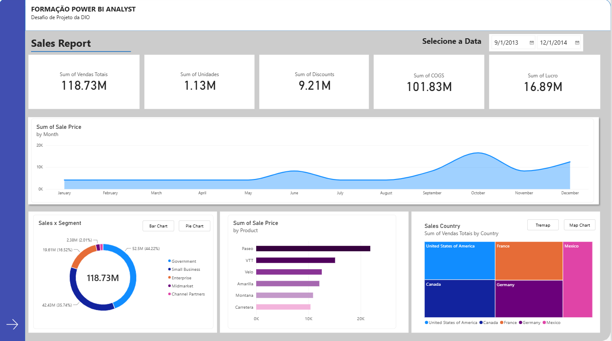
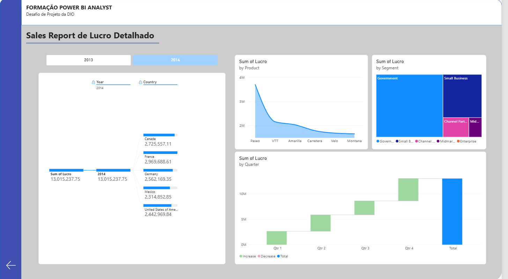

# 📊 Desafio de Projeto Power BI Analyst - DIO

Repositório desenvolvido no âmbito da **Formação Power BI Analyst** da DIO, com o objetivo de consolidar competências em modelagem de dados, tratamento analítico e construção de relatórios interativos e orientados a negócios (*Business Intelligence*).

---

## 🎯 Sobre o Projeto
O projeto consiste num relatório dinâmico e multifacetado focado na análise detalhada de **Vendas e Lucros** (`Sales Report`). O *dashboard* foi estruturado para fornecer *insights* executivos rápidos, permitindo cruzar métricas financeiras por diferentes dimensões geográficas, temporais, de produtos e de segmentos de mercado.

---

## 🛠️ Estrutura e Funcionalidades do Relatório

O relatório foi concebido em páginas temáticas com uma identidade visual consistente (paleta corporativa em tons de azul e cinzento):

### 📄 Página 1: Visão Geral Executiva
- **Indicadores de Desempenho (KPIs):** Resumo consolidado de receitas, custos e margens de lucro globais.
- **Navegação Inteligente:** Botões interativos integrados para transição fluida entre as páginas do relatório.

### 📄 Página 2: Relatório de Lucro Detalhado (`Sales Report de Lucro Detalhado`)
- **Filtro Temporal Interativo:** Segmentação de dados por ano (`2013` e `2014`) com botões em mosaico estilizados.
- **Árvore de Decomposição (*Decomposition Tree*):** Visual analítico configurado para explorar o `Sum of Lucro` ramificado por **Ano** e **País**, permitindo identificar rapidamente os mercados mais rentáveis.
- **Análise de Produtos (Gráfico de Área):** Visualização da evolução e distribuição do lucro por produto (como *Paseo*, *VTT*, *Amarilla*, entre outros).
- **Segmentação de Mercado (*Treemap*):** Distribuição proporcional do lucro por segmentos de clientes (*Government*, *Small Business*, *Channel Partners*, etc.).
- **Análise Trimestral (*Waterfall / Cascata*):** Acompanhamento da variação e impacto financeiro trimestre a trimestre.

## 📸 Pré-visualização do Relatório

### Página 1: Visão Geral Executiva

### Página 2: Lucro Detalhado

---

## ⚙️ Tecnologias e Ferramentas Utilizadas
- **Power BI Desktop:** Modelagem relacional, criação de medidas DAX e design de interfaces.
- **Power Query:** Limpeza, transformação e tratamento inicial da base de dados financeira (`financials`).
- **Git & GitHub:** Controlo de versão, alojamento de código e documentação de portfólio.

---

## 👨‍💻 Autor
Desenvolvido por **Gabriela Pereira das Neves** no âmbito da jornada de transição e especialização em Dados e Tecnologia.
